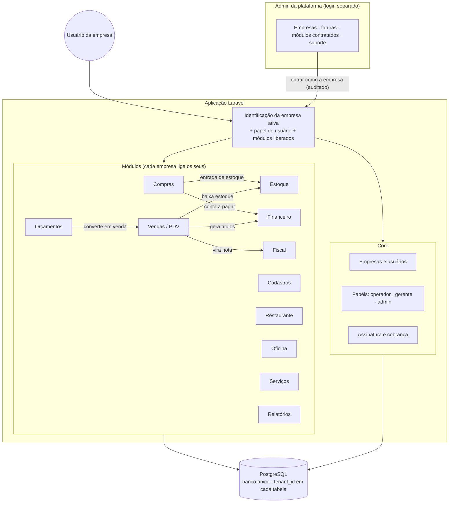
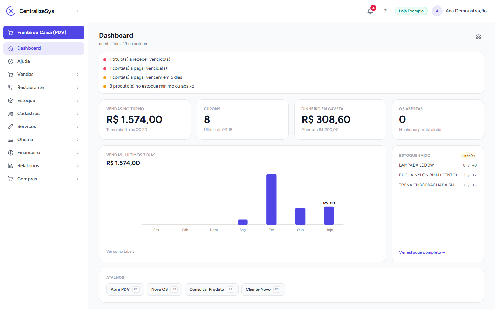
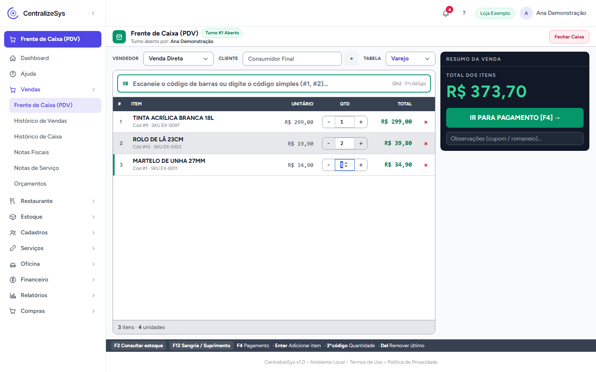
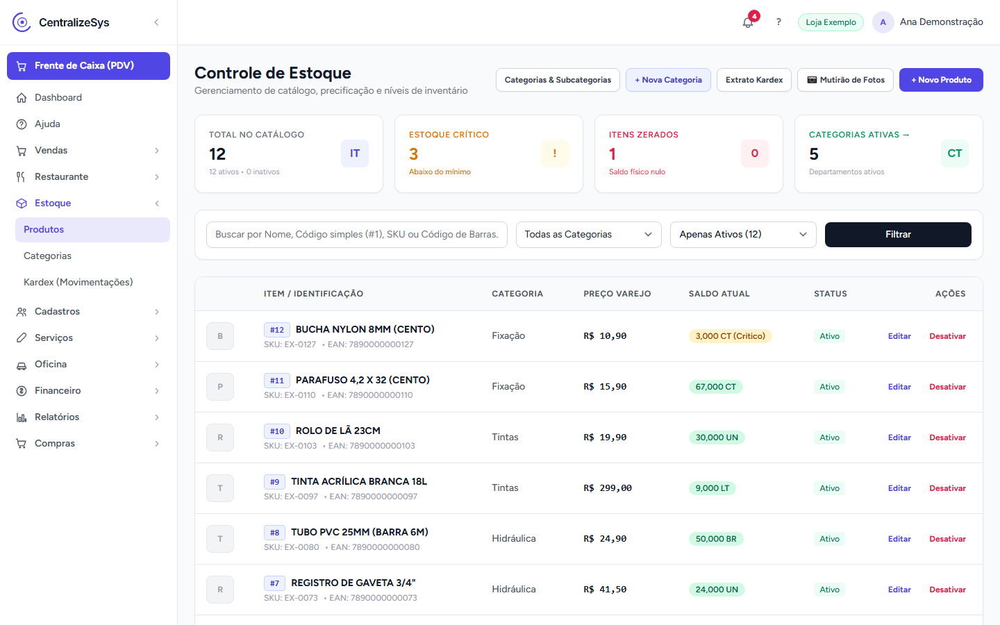
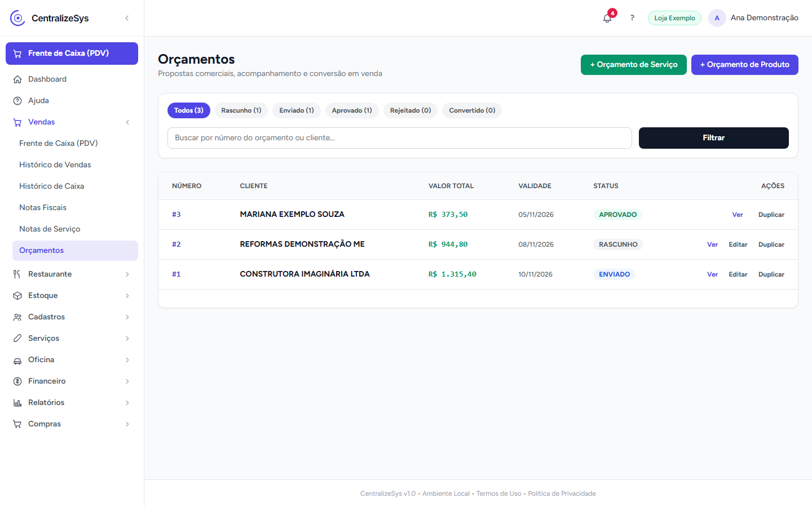
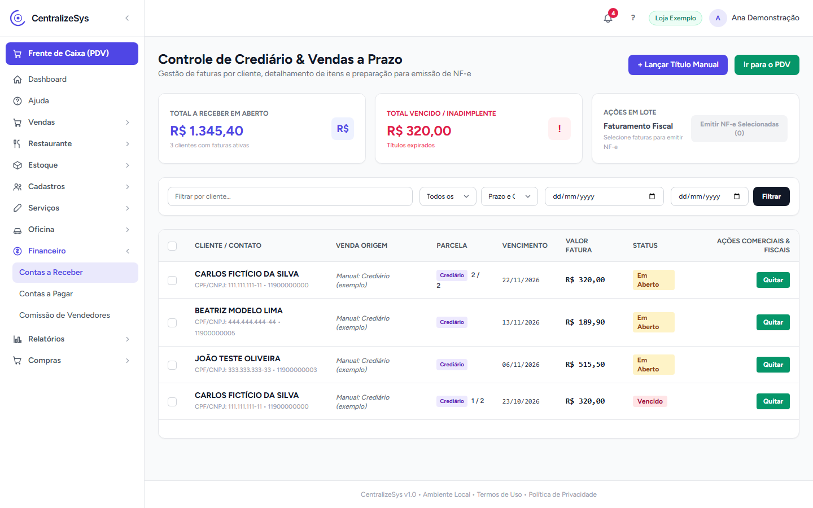
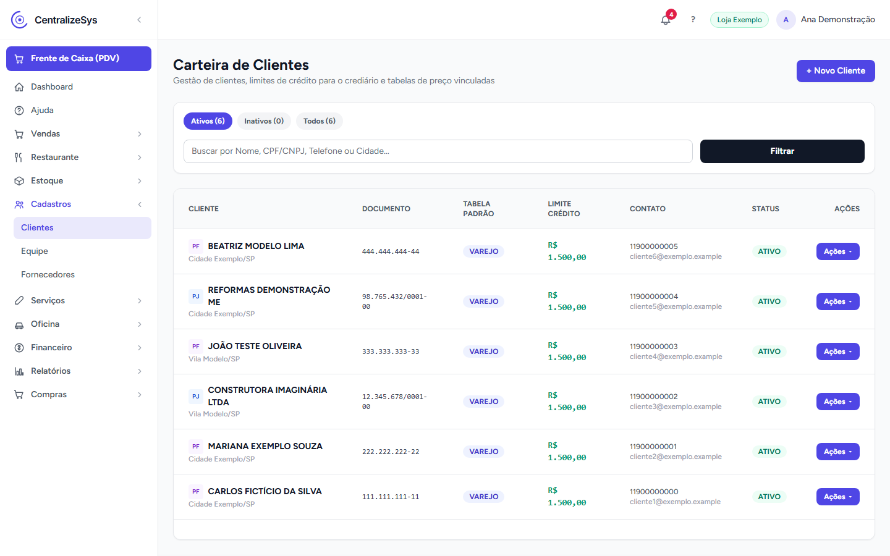

# CentralizeSys — ERP modular para pequenas empresas

Sistema de gestão 100% online que reúne estoque, vendas (PDV), orçamentos, financeiro e emissão
fiscal num só lugar, para o pequeno comércio e prestadores de serviço brasileiros. Cada empresa
liga só os módulos que usa, e todos já nascem conectados: a venda no caixa baixa o estoque, gera o
financeiro e pode virar nota fiscal.

> **Projeto comercial.** O CentralizeSys é um produto que criei e opero, em produção e com clientes
> usando. O código-fonte é privado; este repositório é só uma vitrine. Uma **demonstração ao vivo**
> pode ser feita sob solicitação — veja [Contato](#contato).

## Stack

- **Back-end:** PHP 8.4, Laravel 13, arquitetura modular com `nwidart/laravel-modules`
- **Front-end:** Blade, Alpine.js e Tailwind CSS 4, empacotados com Vite
- **Banco:** PostgreSQL em produção (SQLite nos testes)
- **Fiscal:** NF-e com a biblioteca NFePHP (montagem, assinatura digital e DANFE), NFS-e por webservice da prefeitura
- **Infra:** Railway (aplicação + worker de tarefas agendadas), armazenamento S3-compatível (Cloudflare R2), e-mail transacional, backup diário do banco
- **Qualidade:** PHPUnit com testes paralelos, Laravel Pint

## Módulos

| Módulo | O que faz | Status |
|---|---|---|
| **Core** | Empresas, usuários e papéis de acesso, módulos por empresa, assinatura e cobrança, central de ajuda e chamados | ✅ Em produção |
| **Vendas (PDV)** | Frente de caixa com leitor de código de barras e atalhos de teclado, dois modos de tela, turno de caixa com abertura e fechamento, histórico de vendas, devolução e troca | ✅ Em produção |
| **Estoque** | Catálogo com código de barras, categorias e subcategorias, estoque mínimo e kardex (histórico de toda entrada e saída) | ✅ Em produção |
| **Cadastros** | Clientes, fornecedores e equipe, com limite de crédito, tabela de preço por cliente e importação de dados de sistemas antigos | ✅ Em produção |
| **Orçamentos** | Proposta comercial com validade, impressão em PDF e conversão em venda com um clique | ✅ Em produção |
| **Serviços** | Orçamento de serviço pelo celular, para técnico ou instalador em campo | ✅ Em produção |
| **Compras** | Importa o XML da nota do fornecedor, relaciona os produtos, dá entrada no estoque e gera a conta a pagar | ✅ Em produção |
| **Financeiro** | Contas a pagar e a receber, crediário com baixa parcial, comissão de vendedores, boleto e Pix | ✅ Em produção |
| **Fiscal** | NF-e (inclusive devolução) com tela de revisão antes de emitir, NFS-e e envio mensal ao contador | ✅ Em produção |
| **Restaurante** | Mesas e comandas, acesso da equipe por PIN, delivery e impressão automática na cozinha e no bar | ✅ Em produção |
| **Oficina** | Ordem de serviço com peças e mão de obra, histórico por veículo e busca por placa | ✅ Em produção |
| **Relatórios** | Indicadores de vendas, estoque, fiscal e clientes | ✅ Em produção |
| **Admin da plataforma** | Painel do dono do SaaS: empresas, faturas, módulos contratados, equipe de suporte e atendimento | ✅ Em produção |

## Arquitetura

Escolhi uma **arquitetura modular** porque cada negócio precisa de um pedaço diferente do sistema:
uma loja de ferragens não paga por comandas de restaurante, e uma oficina não precisa de
crediário. Cada módulo tem suas próprias rotas, telas, migrations e testes, e pode ser ligado ou
desligado por empresa. O **isolamento entre empresas** é feito num banco único: toda tabela tem a
coluna da empresa, e um filtro global aplicado automaticamente em todas as consultas garante que uma
empresa nunca enxergue dados de outra. Os **módulos conversam por serviços de domínio**: ao fechar
uma venda, a baixa no estoque, a comissão e os títulos do financeiro são gravados na mesma
transação (ou tudo é gravado, ou nada é), e a nota fiscal é gerada depois a partir da venda.

## Destaques técnicos

- **Isolamento multiempresa automático.** A empresa ativa é identificada a cada requisição, a
  partir do usuário logado (que pode pertencer a várias empresas, com um papel em cada). A partir
  daí, toda leitura e gravação já sai filtrada por empresa, sem depender de o desenvolvedor lembrar
  de filtrar. Os testes automatizados cobrem justamente o cenário "a empresa A não pode ver nem
  alterar dados da empresa B".

- **Suporte com acesso auditado.** O dono da plataforma tem um painel separado, com outro login.
  Para ajudar um cliente, ele pode "entrar como a empresa" a partir de um chamado de suporte, e
  toda ação feita nesse modo fica registrada num log de auditoria: quem fez, em qual empresa, o quê
  e em qual chamado.

- **Nota fiscal com revisão e numeração segura.** Emitir uma NF-e cria primeiro um rascunho
  editável (itens, impostos, pagamento), para evitar nota errada. O número da nota só é reservado no
  momento da emissão, com trava contra duas emissões simultâneas, e uma nota autorizada se torna
  imutável.

- **Compra por XML de ponta a ponta.** Na entrada de mercadoria, o sistema lê o XML da nota do
  fornecedor, relaciona cada item com o produto do catálogo (lembrando o vínculo para as próximas
  compras), dá entrada no estoque, preenche os dados fiscais dos produtos e já gera as parcelas no
  contas a pagar — sem digitar item por item.

- **Operação de SaaS de verdade.** Cadastro self-service com período de teste, planos com módulos
  diferentes, suspensão automática por atraso (com os dados preservados), tarefas agendadas num
  worker próprio, backup diário do banco com retenção e importador de dados para migrar clientes de
  sistemas antigos.

## Telas

> Prints de um ambiente de demonstração com dados **fictícios** ("Loja Exemplo Ltda").

| | |
|---|---|
|  |  |
| **Dashboard** — vendas do turno, gráfico dos últimos 7 dias, alertas de contas e estoque baixo | **Frente de caixa (PDV)** — leitor de código de barras, quantidade rápida e atalhos de teclado |
|  |  |
| **Estoque** — catálogo com saldo, estoque crítico e acesso ao kardex | **Orçamentos** — acompanhamento por status e conversão em venda |
|  |  |
| **Financeiro** — crediário e vendas a prazo, com vencidos em destaque | **Cadastros** — clientes PF e PJ, limite de crédito e tabela de preço |

## Meu papel

Criei o CentralizeSys sozinho e sou responsável por todo o ciclo do produto:

- **Requisitos:** levantamento com os clientes (lojistas, prestadores de serviço e restaurantes),
  acompanhando a rotina real do balcão para desenhar os fluxos.
- **Arquitetura:** definição da estrutura modular, do modelo multiempresa e dos papéis de acesso.
- **Desenvolvimento:** back-end, front-end, integrações fiscais e bancárias, e testes automatizados.
- **Deploy e operação:** infraestrutura em nuvem, backups, migração de dados de clientes e suporte.

## Contato

- LinkedIn: [linkedin.com/in/thomashenrike](https://www.linkedin.com/in/thomashenrike/)
- E-mail: [thomashenrike@outlook.com](mailto:thomashenrike@outlook.com)

Para uma demonstração ao vivo do sistema, é só entrar em contato.
